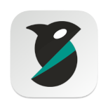
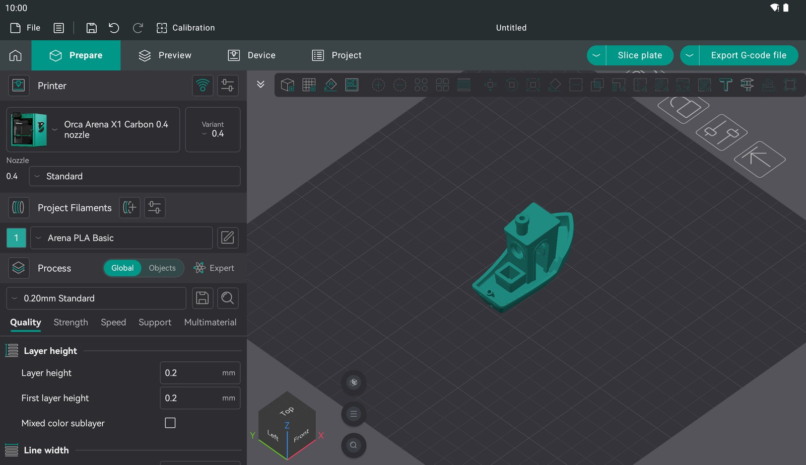
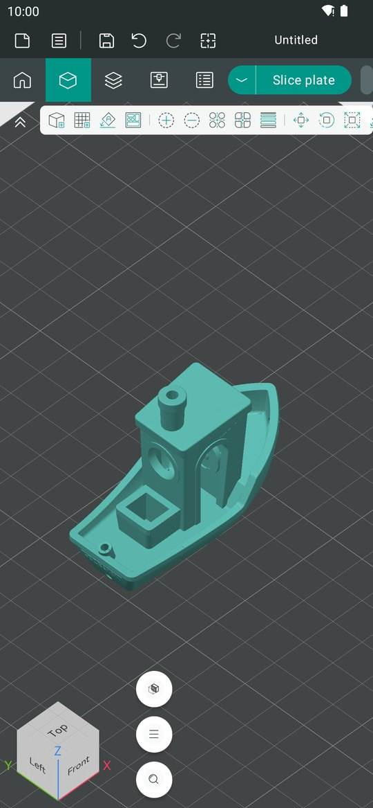

<p align="center">
  
</p>

<h1 align="center">OrcaSlicer for Android</h1>

<p align="center">
  OrcaSlicer on Android phones and tablets: the same slicing engine and the same features as the desktop app, with a native touch interface.
</p>

<p align="center">
  <a href="https://lucascoraca.github.io/orcaslicer-android/"><b>Website</b></a> ·
  <a href="https://github.com/LucasCoraca/orcaslicer-android/releases/latest"><b>Download APK</b></a> ·
  <a href="#building-from-source"><b>Build from source</b></a>
</p>

<p align="center">
  
  &nbsp;
  
</p>

> **Unofficial community port, preview quality.** This project is not affiliated with or endorsed by the OrcaSlicer team.
> Upstream OrcaSlicer lives at [OrcaSlicer/OrcaSlicer](https://github.com/OrcaSlicer/OrcaSlicer).

## What this is

This is not a "mobile companion" with a subset of features. It is built from OrcaSlicer's own source code:

- **Same engine.** `libslic3r` is built unchanged from upstream, so you get the same slicing, the same profiles and the same G-code as the desktop version.
- **Same logic.** The behaviour of the desktop GUI (plates, gizmos, painting, settings tabs, presets, calibration, the G-code viewer, printer connections) is not rewritten. It is compiled from upstream's `src/slic3r/GUI` sources, together with functions extracted from them at build time.
- **Native interface.** The screens are a native Android app (Kotlin, Jetpack Compose) that follows the desktop layout: Prepare, Preview, Device, Project, every dialog and every gizmo, adapted for touch. It does not use wxWidgets or Qt.
- **Made for touch.** Tap, drag and long-press (right click) work in the 3D view. Two fingers pinch to zoom, move to pan and twist to rotate. The Android back button closes dialogs.
- **Phones and tablets.** Tablets get the desktop layout; phones get a compact one.
- **Android integration.** Files open and save through the system file picker, so Google Drive and other providers work. The 3D view renders with OpenGL ES 3, web pages use the system WebView, and the theme and the language follow the system.

In a headset: [OrcaSlicer XR](https://github.com/LucasCoraca/orcaslicer-xr) runs OrcaSlicer on Meta Quest 3.

## Install

1. Download `OrcaSlicer-android-arm64-preview.apk` from the [latest release](https://github.com/LucasCoraca/orcaslicer-android/releases/latest). Almost every phone and tablet since 2017 is arm64. The `x86_64` APK is for emulators and Chromebooks.
2. Allow installing apps from your browser or file manager when Android asks.
3. Open **Orca Slicer**. The first start unpacks the profiles and takes a few seconds.

Requires Android 9 (API 28) or newer and OpenGL ES 3.0. A device with 6 GB of RAM or more is recommended for large models.

## Status

Tested feature by feature against the desktop app on a tablet emulator:

- Import of STL, OBJ (with textures), 3MF, STEP, AMF and ZIP; project save, and backup with restore after a crash.
- Plates and plate settings, arrange, auto-orient, fill bed, undo / redo.
- Every gizmo: move, rotate, scale, lay on face, cut, measure and assembly, text, SVG, mesh boolean, simplify, brim ears, variable layer height, support / seam / color / fuzzy skin painting, and texture displacement with the UV editor.
- Slicing with progress and cancel, slice all, and the Preview with its legend, view types and sliders.
- Every printer, filament and process setting, presets, and the unsaved changes dialog.
- The setup wizard, calibration, printer connections, G-code / 3MF / STL export and translations.

The arm64 build has been run through the emulator's ARM translation. Reports from real devices are welcome.

Known limitations:

- Bambu Lab network printing is not available. It needs Bambu's closed-source network plug-in, which has no Android build.
- Large models are slower than on a desktop. Slicing runs on all CPU cores, but phones have less memory and thermal headroom.

Bug reports with your device model and Android version are very welcome.

## How it works

```
 ┌──────────────────────────────────────────────────────────────┐
 │  Android app  (mobile/app: Kotlin, Jetpack Compose)          │
 │  screens, dialogs and gizmo panels; GLSurfaceView for 3D     │
 ├──────────────────────────────────────────────────────────────┤
 │  JNI: JSON commands and events                               │
 ├──────────────────────────────────────────────────────────────┤
 │  liborcacore.so  (mobile/core)                               │
 │  upstream src/slic3r/GUI sources and extracted functions,    │
 │  compiled against small stand-ins for the wx headers they    │
 │  include; OpenGL ES 3 rendering of the scene and Preview     │
 ├──────────────────────────────────────────────────────────────┤
 │  libslic3r (slicing engine, unchanged), libvgcode, ImGui,    │
 │  Boost, TBB, CGAL, OCCT, OpenVDB … cross-compiled; CPython   │
 │  3.14 for Orca's plugin system                               │
 ├──────────────────────────────────────────────────────────────┤
 │  Android: OpenGL ES 3 / EGL, system WebView, Storage Access  │
 │  Framework, NDK 29, API 28+, arm64-v8a and x86_64            │
 └──────────────────────────────────────────────────────────────┘
```

Where the desktop logic lives inside wx classes, the port compiles the upstream code instead of copying it.
[`mobile/tools/extract_functions.py`](mobile/tools/extract_functions.py) pulls the needed functions and class bodies out
of the upstream sources at build time (see [`mobile/core/CMakeLists.txt`](mobile/core/CMakeLists.txt)), and
[`mobile/core/shim`](mobile/core/shim) provides the wx and GUI declarations they expect. The settings pages are
generated from upstream's `Tab.cpp` by [`mobile/tools/gen_settings_layout.py`](mobile/tools/gen_settings_layout.py).

Changes to upstream OrcaSlicer are kept in one patch,
[`patches/orcaslicer-android.patch`](patches/orcaslicer-android.patch), applied to
[OrcaSlicer](https://github.com/SoftFever/OrcaSlicer) `1ee0b730`. It holds the Android dependency superbuild, GLSL ES
shaders and a GLES loader, and the switch that adds `mobile/core` to the build.

Versions 0.1.x took a different route: they ran Orca's wxWidgets GUI through wxWidgets' Qt backend. That build
([`android/app`](android/app), [`patches/wxWidgets-android.patch`](patches/wxWidgets-android.patch), `build-all.sh`) is
still in the repository but is no longer released.

## Building from source

Host: Linux x86_64 with about 60 GB free disk space. A full build takes a while, so use as many cores as you have.

**Prerequisites**

- Android SDK with NDK `29.0.14206865`, build-tools `34.0.0`, platform `android-34` and CMake `3.22.1`.
- JDK 17. Gradle is fetched by the wrapper in `mobile/app`.
- CMake ≥ 3.28 and Ninja on `PATH`. The scripts look in `hosttools/pyenv/bin` first; `python3 -m venv hosttools/pyenv && hosttools/pyenv/bin/pip install cmake ninja` sets that up.
- GNU m4, for the GMP/MPFR autotools builds.
- CPython 3.14 built for Android, placed in `deps-android/<abi>/usr/local/libpython`. Orca's plugin system needs it.

Paths are read from the environment; see [`env.sh`](env.sh):

```sh
export ANDROID_SDK_ROOT=~/Android/sdk
export JAVA_HOME=~/jdk-17
export ORCA_KEYSTORE=~/.android/debug.keystore    # alias "orcadebug", password "android"
```

**Steps**

```sh
./fetch-sources.sh                                      # pinned OrcaSlicer checkout, patch applied
./configure-deps.sh arm64-v8a && ./run-deps.sh arm64    # Boost, TBB, CGAL, OCCT, OpenVDB, …
BUILD_TYPE=release mobile/build-mobile.sh arm64-v8a     # liborcacore + the APK
```

The APK lands in `mobile/app/app/build/outputs/apk/arm64/release/`. Without `BUILD_TYPE=release` you get a debug build
with the package id `org.orcaport.slicer.dev`, which installs next to a release. `x86_64` builds the same way, for
emulators.

## License

[GNU AGPL-3.0](LICENSE), the same as OrcaSlicer. This port stands on the work of OrcaSlicer, Bambu Studio, PrusaSlicer and Slic3r.
